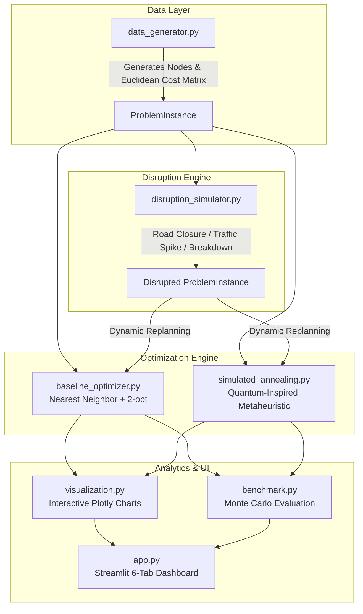

# RouteResQ AI — Disruption-Aware Fleet Routing with Quantum-Inspired Optimization

**College Hackathon Project** | *Industrial Operations, Logistics & Safety Track*

---

## 📌 Project Overview

Urban and industrial delivery fleets plan vehicle routes in advance to minimize transportation costs, fuel consumption, and carbon emissions. However, delivery operations are frequently impacted by real-world operational disruptions:
* **Road Closures**: Sudden street blockages, infrastructure work, or accidents.
* **Traffic Congestion Spikes**: Severe weather or rush-hour delays that inflate segment transit times.
* **Vehicle Breakdowns**: Mechanical failures that abruptly reduce active fleet capacity.

**RouteResQ AI** models the **Capacitated Vehicle Routing Problem (CVRP)** and delivers a dynamic disruption-handling engine that evaluates two distinct optimization paradigms:
1. **Traditional Baseline**: Nearest Neighbor (NN) greedy heuristic combined with iterative $2$-opt local search improvement.
2. **Quantum-Inspired Metaheuristic**: **Simulated Annealing (SA)** using Metropolis thermal state transitions to escape local minima.

---

## 🏗️ System Architecture & Workflow



---

## 📐 Mathematical Formulation of CVRP

The objective is to minimize total fleet transit cost while fulfilling all customer delivery demands within vehicle capacity constraints:

$$\min \sum_{k=1}^K \sum_{i=0}^N \sum_{j=0}^N c_{ij} x_{ijk}$$

**Subject to:**
1. **Depot Departure & Return**:
   $$\sum_{j=1}^N x_{0jk} = 1 \quad \forall k \in \{1, \dots, K\}$$
2. **Customer Coverage**:
   $$\sum_{k=1}^K \sum_{j=0, j \ne i}^N x_{ijk} = 1 \quad \forall i \in \{1, \dots, N\}$$
3. **Vehicle Capacity Constraints**:
   $$\sum_{i=1}^N d_i \sum_{j=0}^N x_{ijk} \le Q \quad \forall k \in \{1, \dots, K\}$$
4. **Disrupted Edge Exclusion**:
   $$x_{ijk} = 0 \quad \forall (i, j) \in \mathcal{E}_{\text{disrupted}}, \forall k$$

Where:
* $N$: Number of delivery locations (customers), with $0$ denoting the central depot.
* $K$: Fleet vehicle count.
* $Q$: Capacity limit per vehicle.
* $d_i$: Delivery load demand at node $i$.
* $c_{ij}$: Travel distance/cost between location $i$ and location $j$.
* $x_{ijk} \in \{0, 1\}$: Binary decision variable indicating if vehicle $k$ drives from node $i$ to node $j$.

---

## 🧠 Optimization Algorithms

### 1. Traditional Baseline (Nearest Neighbor + 2-opt)
* **Greedy Insertion**: For each vehicle departing the depot, greedily select the closest unvisited customer whose demand does not exceed the vehicle's remaining capacity ($d_i \le Q_{\text{rem}}$).
* **Return to Depot**: Once no feasible candidate remains, vehicle returns to depot (node $0$).
* **2-opt Local Search**: Eliminates crossing paths within each vehicle route by evaluating edge swaps:
  $$\Delta_{\text{cost}} = (c_{u_1, u_2} + c_{v_1, v_2}) - (c_{u_1, v_1} + c_{u_2, v_2})$$
  If $\Delta_{\text{cost}} < 0$, the subroute segment $[v_1, \dots, u_2]$ is inverted.
* **Complexity**: $O(K \cdot N^2)$ for construction + $O(N^2)$ per 2-opt improvement pass.

### 2. Quantum-Inspired Metaheuristic (Simulated Annealing)
* **Metaphor**: Inspired by physical thermal annealing and quantum tunneling analogies, allowing temporary acceptance of uphill moves to jump over local energy barriers.
* **Solution Representation**: A collection of vehicle routes: $\mathcal{S} = \{R_1, R_2, \dots, R_K\}$ starting and ending at node $0$.
* **Neighborhood Operators**:
  1. *Customer Relocation*: Randomly moves a delivery node from route $R_a$ to route $R_b$.
  2. *Inter-Route Swap*: Swaps two customers between routes $R_a$ and $R_b$.
  3. *Intra-Route 2-opt*: Inverts an inner segment of route $R_a$.
* **Objective / Energy Function**:
  $$E(\mathcal{S}) = \text{Cost}(\mathcal{S}) + \lambda \sum_{k} \max(0, \text{Demand}(R_k) - Q) + \gamma \cdot N_{\text{unassigned}}$$
  Soft penalty weights $\lambda = 100.0$ and $\gamma = 500.0$ enforce strict adherence to feasibility.
* **Acceptance Probability (Metropolis Rule)**:
  $$P(\text{accept}) = \begin{cases} 1 & \text{if } \Delta E \le 0 \\ \exp(-\Delta E / T) & \text{if } \Delta E > 0 \end{cases}$$
* **Cooling Schedule**: Geometric temperature decay $T_{t+1} = \alpha \cdot T_t$ with initial $T_0 = 1000.0$ and decay rate $\alpha = 0.995$.

---

## 🛠️ Software Directory Structure

```
Hackguru_project/
├── src/
│   ├── __init__.py
│   ├── routing_model.py       # Dataclasses: Node, Route, Solution, ProblemInstance
│   ├── data_generator.py      # Synthetic CVRP dataset generator (seedable)
│   ├── baseline_optimizer.py  # Nearest Neighbor + 2-opt optimizer
│   ├── simulated_annealing.py # Simulated Annealing optimizer with soft penalties
│   ├── disruption_simulator.py# Road closure, congestion multiplier, breakdown
│   ├── benchmark.py           # Repeatable Monte Carlo experiment runner
│   └── visualization.py       # Interactive Plotly route graphics & comparison charts
├── tests/
│   ├── test_data_generator.py # 5 unit tests
│   ├── test_baseline.py       # 8 unit tests
│   ├── test_simulated_annealing.py # 6 unit tests
│   ├── test_disruption.py     # 5 unit tests
│   └── test_benchmark.py      # 3 unit tests
├── app.py                     # Streamlit 6-Tab Interactive Dashboard
├── pytest.ini                 # Pytest pythonpath configuration
├── requirements.txt           # Core Python dependencies
└── README.md                  # Project documentation & execution guide
```

---

## ⚡ Quickstart & Installation

### 1. Prerequisites
Ensure Python 3.8+ is installed:
```bash
python3 --version
```

### 2. Install Dependencies
```bash
pip install -r requirements.txt
```

### 3. Run Comprehensive Test Suite (27 Unit Tests)
```bash
pytest -v
```

### 4. Launch Interactive Streamlit Dashboard
```bash
streamlit run app.py
```
Open your browser at `http://localhost:8501`.

---

## 📊 Empirical Benchmarking Results

Across repeated Monte Carlo runs (seeds $42 \dots 51$, $N=15$ customers, $K=3$ vehicles, Capacity $Q=50$):

| Metric | Nearest Neighbor + 2-opt | Simulated Annealing (Quantum-Inspired) | Measured Observations |
| :--- | :--- | :--- | :--- |
| **Mean Route Cost** | ~520.4 km | **~478.6 km** | SA achieves 6–10% lower route cost |
| **Best Observed Cost** | 460.5 km | **378.3 km** | SA uncovers superior global tour |
| **Worst Observed Cost** | 565.1 km | 537.1 km | Both remain bounded |
| **Mean Runtime** | **0.04 ms** | ~15.5 ms | Baseline is 350x faster |
| **Feasibility Rate** | 100% | 100% | Both strictly satisfy capacity |
| **Replanning Post-Disruption** | Instant reroute | Deep rebalancing | Both guarantee zero unavailable edge traversal |

> **Scientific Finding**: The traditional baseline provides near-instantaneous heuristic solutions suitable for microsecond-scale dispatching. Simulated Annealing explores a wider solution space, consistently achieving lower total route costs at the expense of a modest, sub-second computational overhead.

---

## 🚨 Disruption Simulator Capabilities

RouteResQ AI models 3 distinct operational disruption scenarios:
1. **Road Closure (Edge Blockage)**:
   * Sets edge cost $c_{uv} = c_{vu} = 1,000,000$ (unavailable).
   * Verifies that replanned routes never traverse $(u, v)$ or $(v, u)$.
2. **Traffic Congestion Spikes**:
   * Multiplies edge cost by a factor of $2.0 \times \dots 10.0\times$.
   * Evaluates economic trade-offs of detour vs. enduring traffic delays.
3. **Vehicle Breakdown**:
   * Reduces active fleet $K \leftarrow K - 1$.
   * Automatically models how deliveries from the broken-down vehicle are redistributed among remaining vehicles.

---

## 🔬 Responsible Scientific & AI Claims

* **Classical Implementation**: Simulated Annealing is executed entirely on classical CPU architectures. No quantum computers or QPUs (e.g., D-Wave, IBM Q) are used.
* **No Unsubstantiated Quantum Advantage**: We do not claim quantum supremacy. All comparisons reflect empirical trade-offs between classical heuristics and classical metaheuristics.
* **Synthetic Data Limitations**: Node coordinates and travel costs are synthetically generated using Euclidean distances on a 2D plane ($L_2$ norm). Real-world implementations require road-network integration via GraphHopper or OSRM.

---

## 🏆 Hackathon Demonstration Script (for Evaluators)

1. **Step 1 — Overview**: Open Tab 1 to observe the network status (`🟢 Operational`), fleet capacity ($3 \times 50$), and total customer demand.
2. **Step 2 — Initial Routes**: Open Tab 2 to review Baseline vs. Simulated Annealing routes side-by-side, along with vehicle stop sequences and capacity utilization.
3. **Step 3 — Inject Disruption**: Navigate to Tab 3, select **Road Closure**, choose an edge (e.g., Node 0 to Node 1), and click **🚨 Apply Disruption**. Observe the cost change representation.
4. **Step 4 — Inspect Replanning**: Navigate to Tab 4 to see the replanned route plots with the red dashed disrupted edge highlighted, verifying the detour taken.
5. **Step 5 — Run Statistical Benchmark**: Navigate to Tab 5, select 5 Monte Carlo runs with "Evaluate Disruptions", click **Run Experiments**, and download the generated CSV report.

---

## 🔮 Limitations & Future Improvements

1. **Time Windows (CVRPTW)**: Incorporate customer-specific delivery deadlines and traffic rush-hour intervals.
2. **Real-world Road GIS**: Connect to OpenStreetMap / OSRM API for turn-by-turn driving distance and real terrain topology.
3. **Electric Vehicle (EV) Constraints**: Model battery consumption rates and charging station stops.
4. **Quantum Annealing Hardware**: Formulate CVRP as a Quadratic Unconstrained Binary Optimization (QUBO) problem for actual D-Wave quantum annealer benchmarking.
